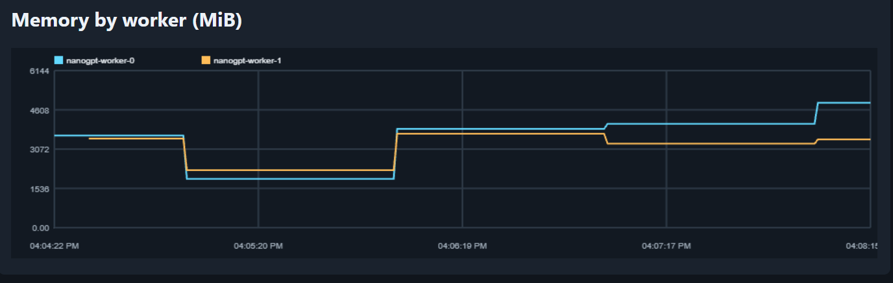

# Distributed nanoGPT training

Simulate a distributed training environment with a separate tokenizer Job and CPU training workers.

## Run with Minikube

Install Docker Desktop, Minikube, `kubectl`, and Helm, then start a local cluster:

This starts a local Minikube cluster. Run Helm and `kubectl` commands from your terminal

```powershell
minikube start --driver=docker --cpus=8 --memory=16384
```
Once the container starts you can view all pods

```bash
kubectl get pods -A
```


Build images and load them into Minikube:

```bash
docker compose build --no-cache
minikube image load trainer:latest
minikube image load tokenizer:latest
minikube image load monitor:latest
minikube image ls
```


Run the kubernetes config with the helm chart

bash
```
helm upgrade --install nanogpt .\k8s\nanogpt\
```

View worker container logs

bash
```
k logs -f -l app=nanogpt-worker
```
# Data Parallelism (DP)
git commit `0878a04de6fe2aadde46fb08a19973223bcd97b1`
At this stage this project is using Data Parallelism

### OOM Error
An out-of-memory condition caused the kernel to SIGKILL one training process (-9). Its local torchrun launcher terminated its sibling processes with SIGTERM (-15). The other nodes then detected the failed distributed training group and their launchers shut down their remaining local processes.


Increase memory per container or decrease `NPROC_PER_NODE`. I did both, as you can see below the memory is within the 6GB allowance I am giving each pod. 




During real distributed training your VRAM and `NPROC_PER_NODE` would have a hard limit you would have to decrease model size `N_LAYER`, `C` or microbatch dimensions `B`, `T` to fit it into VRAM.

## Metrics Monitor Container

```powershell
kubectl port-forward service/nanogpt-monitor 8080:8080
```

Visit `http://localhost:8080`. The monitor needs the Minikube `metrics-server`
addon running because it reads its Metrics API. It polls worker CPU and memory
every second; global rank 0 publishes loss, step duration, and throughput after
each optimizer step. Worker CPU and memory chart ceilings come from
`workerResources.limits` in `k8s/nanogpt/values.yaml`.

## Checkpoint and resume training

The trainer saves a complete checkpoint every `CHECKPOINT_STEPS` completed
optimizer steps under `/checkpoints/checkpoint-<step>`. Each checkpoint contains
model weights, AdamW state, the next training step, every rank's data position,
and each rank's random-number state. These files are on the shared PVC.

To resume from the most recently completed checkpoint, set the following before
building the trainer image and restarting the workers:

```dotenv
RESUME_CHECKPOINT=latest
```

Leave `RESUME_CHECKPOINT` empty to start a new run. Resume requires the same
number of distributed processes because each rank restores its own data cursor.

### View Logs from training containers

bash
```
kubectl logs -f -l app=nanogpt-worker -c trainer --prefix=true --max-log-requests=10
```
