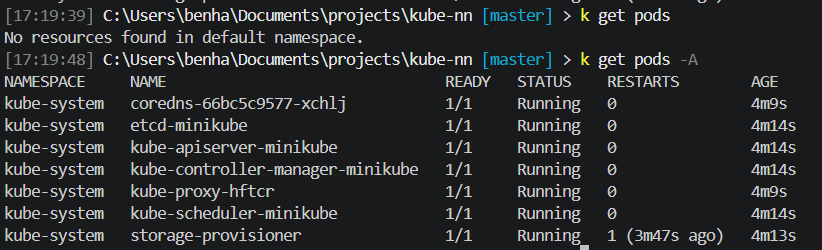
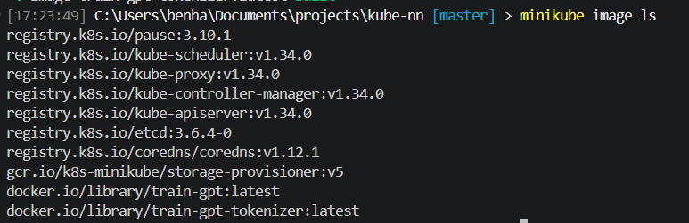
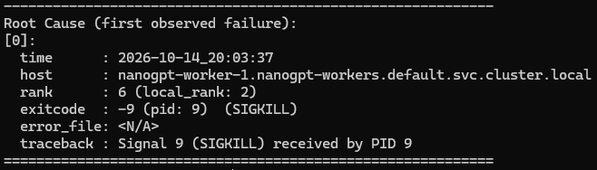

# Distributed nanoGPT training

Simulate a distributed training environment with a separate tokenizer Job and CPU training workers.

## Run with Minikube

Install Docker Desktop, Minikube, `kubectl`, and Helm, then start a local cluster:

This starts a local Minikube cluster. Run Helm and `kubectl` commands from your terminal; you do not need to enter the Minikube node.

```powershell
minikube start --driver=docker --cpus=8 --memory=16384
```
Once the container starts you can view all pods

```bash
kubectl get pods -A
```


Build images and load them into Minikube:

```powershell
docker compose build
minikube image load train-gpt:latest
minikube image load train-gpt-tokenizer:latest
minikube image load nanogpt-monitor:latest
```


Run the kubernetes config with the helm chart

bash
```
helm upgrade --install nanogpt .\k8s\nanogpt\
```

View worker container logs

bash
```
k logs -f -l app=nanogpt-worker
```

An out-of-memory condition caused the kernel to SIGKILL one training process (-9). Its local torchrun launcher terminated its sibling processes with SIGTERM (-15). The other nodes then detected the failed distributed training group and their launchers shut down their remaining local processes.



### Worker resource monitor

The chart includes a small monitor that requests worker CPU and memory usage from
the Kubernetes Metrics API every second. It keeps the most recent hour in memory
and graphs each worker Pod in a browser.

Build and load its image with the other local images:

```powershell
```

After the Helm upgrade, open the dashboard:

```powershell
kubectl port-forward service/nanogpt-monitor 8080:8080
```

Visit `http://localhost:8080`. The monitor needs the Minikube `metrics-server`
addon running because it reads its Metrics API.


View Logs

bash
```
kubectl logs -f -l app=nanogpt-worker -c trainer --prefix=true --max-log-requests=10
```


### Run distributed locally

Minikube can simulate a distributed run with multiple worker Pods on its single Kubernetes node. Set `nnodes: 2` (or more) in `k8s/nanogpt/values.yaml`, then rerun the Helm command below; Helm sets the same count for the StatefulSet and `torchrun`. The Pods share Minikube's CPU and memory, so keep the count within the resources allocated at startup.

Install or update the training and tokenizer resources with Helm:

```powershell
helm upgrade --install nanogpt .\k8s\nanogpt --set-string tokenizer.imageHash=$tokenizerImageHash
```

Helm creates a tokenizer Job for each image and tokenizer configuration. After rebuilding the tokenizer image, inspect its ID and pass the new value on the Helm command so Helm creates a new Job automatically. Changing tokenizer settings also creates a new Job. The trainer waits only until it finds a `*_train_*.npy` file in `/data`; it does not wait for a particular tokenizer run or shard layout. To scale the training workers, change `nnodes` in `k8s/nanogpt/values.yaml` and run the Helm command again with the same image hash.


```

The tokenizer writes train and validation `.npy` shards to the PVC. The training Pod waits for those files, then starts `torchrun`.
