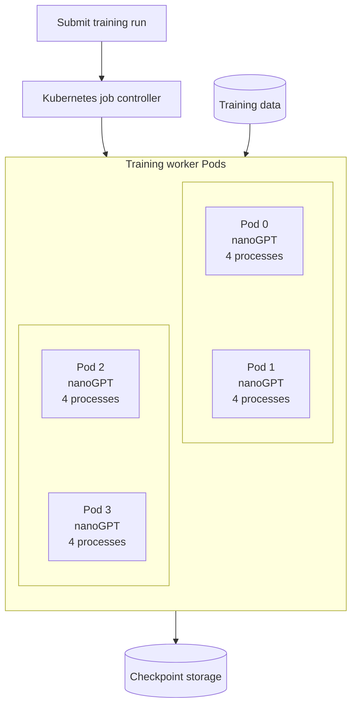

# Distributed nanoGPT training architecture

One training run has four worker Pods, each running one nanoGPT container with four processes.

Workers read the shared dataset and save checkpoints to durable storage. Gloo runs inside the worker processes for CPU training; GPU training typically uses NCCL.
